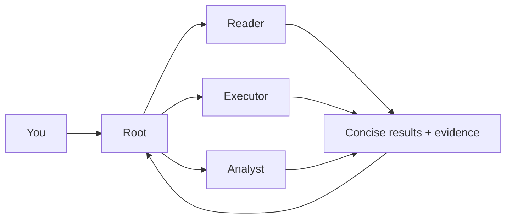

**English** | [简体中文](README.zh-CN.md)

# HCCA Official

HCCA Official 0.2.1 gives reading, execution, and retries their own contexts. Keep the main agent's input small and reuse stable prompt prefixes.

## How it works

Root plans and integrates the work. Each delegated task starts with a fresh context and shared role prompts, keeping tool output and retry history local to the worker.



| Mode | Who plans the work | Start here |
| --- | --- | --- |
| DSH plugin | Your DSH chat acts as Root | Install the plugin and select HCCA |
| Standalone | HCCA runs its own Root | Use the command below |

## Frozen v7 benchmark

SWE-bench Verified Mini, 50 tasks. HCCA has 49 official evaluations and one unfinished task counted as unresolved.

| Frozen run | Resolved | Input tokens | Cached input | Output tokens | Normalized cost |
| --- | --- | --- | --- | --- | --- |
| **HCCA v7** · direct executor · low | **36/50 (72%)** | **36.811M** | **35.850M** | **0.654M** | **$0.644** |
| DSH minimal · high | 35/50 (70%) | ≥ 106.265M | ≥ 104.137M | ≥ 4.050M | ≥ $3.062 |

Both used GXWTF, the `deepseek-v4.1-flash` model alias, and two concurrent tasks. The DSH baseline is reused from its frozen run. Its partial usage record makes token and cost totals lower bounds. Costs use common cache-aware rates. The different reasoning efforts limit attribution to architecture.

These results describe the frozen v7 benchmark runner. HCCA Official 0.2.1 is the current Windows and DSH runtime distribution. [Benchmark details](docs/BENCHMARK-v7-2026-11-12.md) · [Paper](https://github.com/klarisaka/HCCA/blob/5899faf6fefa2babae641d46ada98e8f60aa2670/paper/hcca-v7-2026-11-12/main.pdf).

## Use with DSH

You need Python 3.11+, the DSH CLI, and pnpm. Install from the full repository:

```sh
git clone https://github.com/klarisaka/HCCA-Official.git
cd HCCA-Official
python integrations/dsh-hcca/install.py --profile web
```

For the desktop app, replace `web` with `desktop`. [Configure the HCCA worker model](docs/USAGE.md#model-connection), restart DSH, and select **HCCA** in a new chat.

Describe your task in chat. Root delegates reading, execution, or analysis as needed. Executors can adjust their approach and retry after failures. The **HCCA tab** shows worker progress, token usage, cache hit rate, and results.

Send follow-up instructions in the same chat while work is running. Root decides what needs to change and passes relevant updates down the task hierarchy.

## Run standalone

After [configuring a model](docs/USAGE.md#model-connection), run from the repository root with your workspace path:

```sh
python -m hcca.runner --goal "Complete your task" --workspace "/path/to/project" --out "./runs/example"
```

Open a dashboard for that run:

```sh
python -m hcca.dsh_worker --runs "./runs" --port 8765
```

Visit <http://127.0.0.1:8765/>.

## Learn more

[Usage and configuration](docs/USAGE.md) · [DSH integration](integrations/dsh-hcca/README.md) · [Architecture](docs/ARCHITECTURE.md) · [Benchmark harness](benchmarks/README.md) · [Past experiments](docs/USAGE.md#past-experiments)

## License

HCCA's original code is licensed under [AGPL-3.0-only](LICENSE). See [third-party notices](THIRD_PARTY_NOTICES.md) for external materials.
