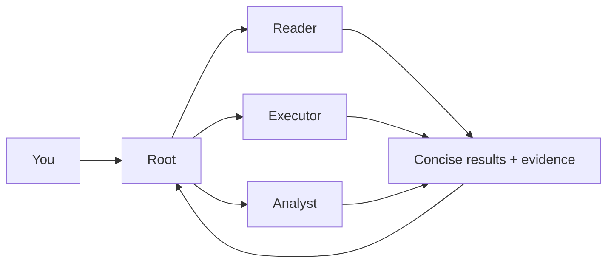

**English** | [简体中文](README.zh-CN.md)

# HCCA Official

HCCA Official 0.2.1 gives reading, execution, and retries their own contexts. Keep the main agent's input small and reuse stable prompt prefixes.

## How it works

Root plans and integrates the work. Each delegated task starts with a fresh context and shared role prompts, keeping tool output and retry history local to the worker.



| Mode | Who plans the work | Start here |
| --- | --- | --- |
| DSH plugin | Your DSH chat acts as Root | Install the plugin and select HCCA |
| Standalone | HCCA runs its own Root | Use the command below |

## Historical benchmark

Historical SWE-bench Verified Mini, all 50 tasks scored by the official evaluator.

| Frozen run | Resolved | Normalized cost |
| --- | --- | --- |
| **HCCA v6** · direct executor · low | **38/50 (76%)** | **$0.739** |
| DSH minimal · high | 35/50 (70%) | ≥ $3.062 |

HCCA used DeepSeek official and DSH used GXWTF. Costs use common off-peak rates. One partial DSH usage record makes its cost a lower bound. [Configuration and accounting](https://github.com/klarisaka/HCCA/blob/d337069fa8b81851d2086482992edd560244f4b6/reports/verified50-hcca-v6-vs-dsh-summary.json).

## Use with DSH

You need Python 3.11+, the DSH CLI, and pnpm. Install from the full repository:

```sh
git clone https://github.com/klarisaka/HCCA-Official.git
cd HCCA-Official
python integrations/dsh-hcca/install.py --profile web
```

For the desktop app, replace `web` with `desktop`. [Configure the HCCA worker model](docs/USAGE.md#model-connection), restart DSH, and select **HCCA** in a new chat.

Describe your task in chat. Root delegates reading, execution, or analysis as needed. Executors can adjust their approach and retry after failures. The **HCCA tab** shows worker progress, token usage, cache hit rate, and results.

Send follow-up instructions in the same chat while work is running. Root decides what needs to change and passes relevant updates down the task hierarchy.

## Run standalone

After [configuring a model](docs/USAGE.md#model-connection), run from the repository root with your workspace path:

```sh
python -m hcca.runner --goal "Complete your task" --workspace "/path/to/project" --out "./runs/example"
```

Open a dashboard for that run:

```sh
python -m hcca.dsh_worker --runs "./runs" --port 8765
```

Visit <http://127.0.0.1:8765/>.

## Learn more

[Usage and configuration](docs/USAGE.md) · [DSH integration](integrations/dsh-hcca/README.md) · [Architecture](docs/ARCHITECTURE.md) · [Benchmark harness](benchmarks/README.md) · [Past experiments](docs/USAGE.md#past-experiments)

## License

HCCA's original code is licensed under [AGPL-3.0-only](LICENSE). See [third-party notices](THIRD_PARTY_NOTICES.md) for external materials.
