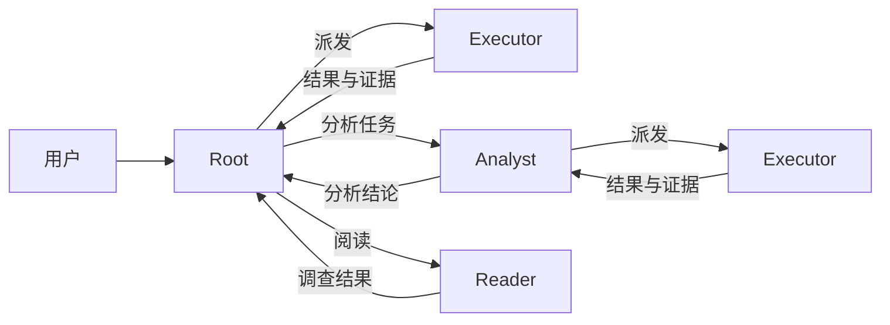

[English](README.md) | **简体中文**

# HCCA Official

HCCA Official 0.2.1 把阅读、执行和重试放进独立上下文，减少主 Agent 的输入，并复用稳定的提示词前缀。

## 如何工作

Root 负责规划与整合。每次委派都开启独立上下文，复用共享角色提示词，工具输出和重试历史保留在对应 worker 内。



每个 Executor 方框表示一次独立任务上下文，复用同一角色配置。结果返回发起任务的直属上级。

| 用法 | 谁负责规划 | 从哪里开始 |
| --- | --- | --- |
| DSH 插件 | DSH 聊天直接作为 Root | 安装插件，在 DSH 中选择 HCCA |
| 独立运行 | HCCA 自身作为 Root | 使用下面的命令 |

## 冻结 v7 基准结果

SWE-bench Verified Mini，共 50 题。HCCA 有 49 题取得官方评测结果，1 题未完成，计为未通过。

| 冻结版本 | 通过题数 | 输入 token | 缓存输入 | 输出 token | 归一费用 |
| --- | --- | --- | --- | --- | --- |
| **HCCA v7** · 按角色混合推理 | **36/50（72%）** | **36.811M** | **35.850M** | **0.654M** | **$0.644** |
| DSH 极简 · high | 35/50（70%） | ≥ 106.265M | ≥ 104.137M | ≥ 4.050M | ≥ $3.062 |

v7 按角色配置混合推理，思考、规划与 Analyst 使用 `high`，执行与阅读使用 `low`。本轮直接执行路径记录了 1,301 次 `low` 请求、0 次 `high` 请求。

双方均使用 GXWTF、`deepseek-v4.1-flash` 模型别名和 2 题并发。DSH 复用已冻结的基线运行，其一条用量记录不完整，因此 token 总量和费用为下界。费用统一按缓存感知价格归一。推理强度的差异限制了对架构效果的单独归因。

上述结果对应冻结 v7 基准运行器。HCCA Official 0.2.1 是当前的 Windows 与 DSH runtime 发行版。[基准明细](docs/BENCHMARK-v7-2026-11-12.zh-CN.md) · [论文](paper/hcca-v7-2026-11-12/main.pdf)。

## 在 DSH 中使用

准备 Python 3.11+、DSH CLI 和 pnpm。在完整仓库中安装：

```sh
git clone https://github.com/klarisaka/HCCA-Official.git
cd HCCA-Official
python integrations/dsh-hcca/install.py --profile web
```

桌面版将 `web` 改为 `desktop`。按[模型连接说明](docs/USAGE.zh-CN.md#模型连接)配置 HCCA worker 的模型，重启 DSH，新建会话并选择 **HCCA**。

在聊天中提出任务，Root 会按需派发阅读、执行或分析；执行 Agent 可以根据失败结果自行调整并重试。**HCCA 选项卡**显示子任务进度、token 用量、缓存命中率和结果。

执行中可直接在聊天里补充要求。Root 先判断影响范围，再逐层调整相关子任务。

## 独立运行

配置好[模型连接](docs/USAGE.zh-CN.md#模型连接)后，在仓库根目录运行，替换工作区路径：

```sh
python -m hcca.runner --goal "完成你的任务" --workspace "/path/to/project" --out "./runs/example"
```

查看本次运行的面板：

```sh
python -m hcca.dsh_worker --runs "./runs" --port 8765
```

打开 <http://127.0.0.1:8765/>，选择 `example` 运行。

## 更多

[使用与配置](docs/USAGE.zh-CN.md) · [DSH 集成](integrations/dsh-hcca/README.zh-CN.md) · [架构设计](docs/ARCHITECTURE.zh-CN.md) · [基准工具](benchmarks/README.md) · [历史实验](docs/USAGE.zh-CN.md#历史实验)

## 开源协议

HCCA 自有代码采用 [AGPL-3.0-only](LICENSE)。第三方材料见[来源与授权说明](THIRD_PARTY_NOTICES.md)。
