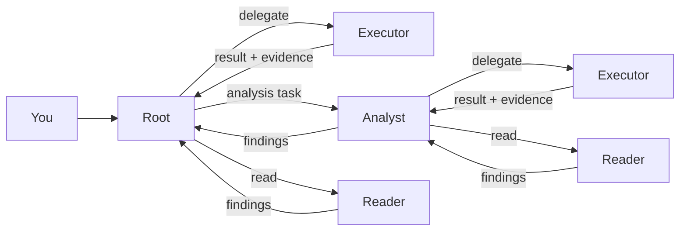

**English** | [简体中文](ARCHITECTURE.zh-CN.md) · [Project home](../README.md)

# HCCA Official 0.2.1 architecture

## Root and workers

Root decides what to do, delegates bounded tasks, and integrates the results. Workers carry the detailed reading, tool output, and execution history for their own assignments.

| Entry point | Root | Workers |
| --- | --- | --- |
| DSH plugin | The current DSH chat | HCCA reader, executor, and analyst |
| Standalone | HCCA's built-in planner | The same worker roles |

The DSH plugin dispatches directly to a worker entry point. Its planning and final response stay in the DSH chat. The standalone entry point is `python -m hcca.runner`.

Each Executor box represents an independent assignment using the shared role configuration. Results return to the parent that requested the task.

## Context and cache reuse

Each assignment starts with a fresh worker context. Shared reader and executor role configurations live in `~/.hcca/agents`, configurable with `HCCA_AGENT_HOME`. Stable role prompts occupy the system prefix. Task details, tool results, and later guidance enter the changing conversation tail.

Root and analysts can both delegate to an executor. The executor returns its result to the caller, which inspects the evidence and decides whether to issue another assignment. Reader results follow the same parent-return relationship. Analyst command and test assignments use `delegate_execution`, with the requested mode and available write tools governed by the task's permissions.

Workers return concise results and evidence references to their parent. An executor can inspect a failed command, revise its approach, and retry within its own task. This keeps repeated tool output and recovery history close to the work that produced them.

HCCA supports mixed reasoning by role. In the DSH integration, analysts use `high` reasoning and readers and executors use `low`. DSH controls Root's model. HCCA workers have their own model connection. Requests omit output token caps.

## Guidance during execution

New user messages go to Root. Root determines the affected tasks and sends targeted guidance down the hierarchy. A parent can adjust its active direct children, and each child can plan further changes for its own children.

Guidance is persisted in a queue and enters the recipient's next model input. Delivery receipts show whether a message is queued or included in that input. A command already running reaches its current execution boundary before the worker takes another step.

Queue, status, and dashboard operations run locally. Model calls occur when an agent takes a step. The DSH chat can receive follow-up messages while a worker continues running.

## Progress and workspace access

The dashboard tracks workers, commands, results, token usage, cache reuse, and guidance receipts. The DSH view groups workers from the current chat. Its usage figures cover HCCA workers, while DSH records Root's consumption.

The sidecar coordinates workspace writers. A second executor requesting a workspace with an active writer receives a conflict that Root can use to schedule the work. Readers and analysts can run alongside independent tasks.

Configuration, default budgets, and both launch commands are in the [usage guide](USAGE.md).
