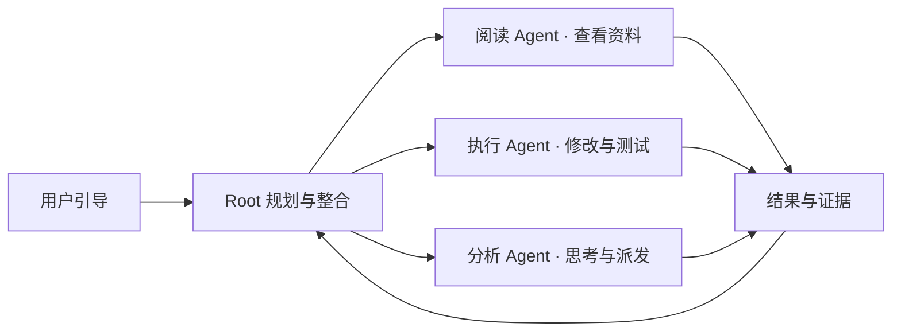

[English](ARCHITECTURE.md) | **简体中文** · [项目首页](../README.zh-CN.md)

# HCCA Official 0.2.1 架构

## Root 与 worker

Root 决定任务方向、派发范围明确的子任务，再整合结果。worker 在各自上下文中保存详细阅读、工具输出和执行历史。

| 入口 | Root | worker |
| --- | --- | --- |
| DSH 插件 | 当前 DSH 聊天 | HCCA reader、executor 与 analyst |
| 独立运行 | HCCA 自带规划器 | 同一套 worker 角色 |

DSH 插件直接调用 worker 入口，规划和最终答复由 DSH 聊天完成。独立入口为 `python -m hcca.runner`。

## 上下文与缓存复用

每次任务都开启独立 worker 上下文。共享 reader 和 executor 角色配置默认位于 `~/.hcca/agents`，可用 `HCCA_AGENT_HOME` 调整。稳定的角色提示词放在 system 前缀，任务信息、工具结果与后续引导进入动态会话尾部。

worker 向上级返回简洁结果与证据引用。执行 Agent 可以查看失败命令、调整方法，再在当前任务内重试，使重复工具输出和纠错历史留在产生这些信息的任务附近。

DSH 集成中的 analyst 使用 `high` 推理，reader 和 executor 使用 `low`。Root 模型由 DSH 配置，HCCA worker 单独配置模型连接。请求省略输出 token 上限。

## 执行中的引导

新的用户消息先交给 Root。Root 判断影响范围，再向相关下级定向发送引导。上级可以调整自己的活跃直属下级，每个下级再规划自己负责的下一层任务。

引导持久保存在队列中，并进入接收者下一轮模型输入。投递回执区分「排队」与「已加入输入」。已经运行的命令到达当前执行边界后，worker 才进入下一步。

队列、状态查询和面板由本地运行时处理，模型在 Agent 采取下一步时调用。worker 执行期间，DSH 聊天仍能接收补充消息。

## 进度与工作区访问

面板展示 worker、命令、结果、token 用量、缓存复用和引导回执。DSH 页面聚合同会话的 workers，用量覆盖 HCCA worker，Root 的消耗由 DSH 记录。

sidecar 协调工作区写入。某个工作区已有执行 Agent 写入时，另一个执行 Agent 会收到冲突，由 Root 调整任务次序。阅读与分析 Agent 可以配合独立任务并行运行。

配置、默认预算与两种启动方式见[使用指南](USAGE.zh-CN.md)。
